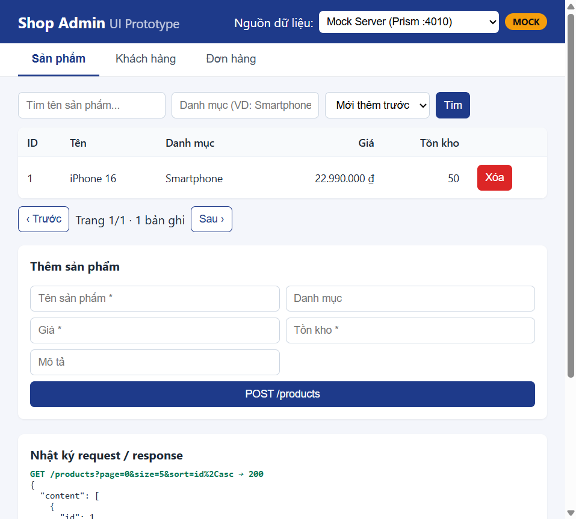
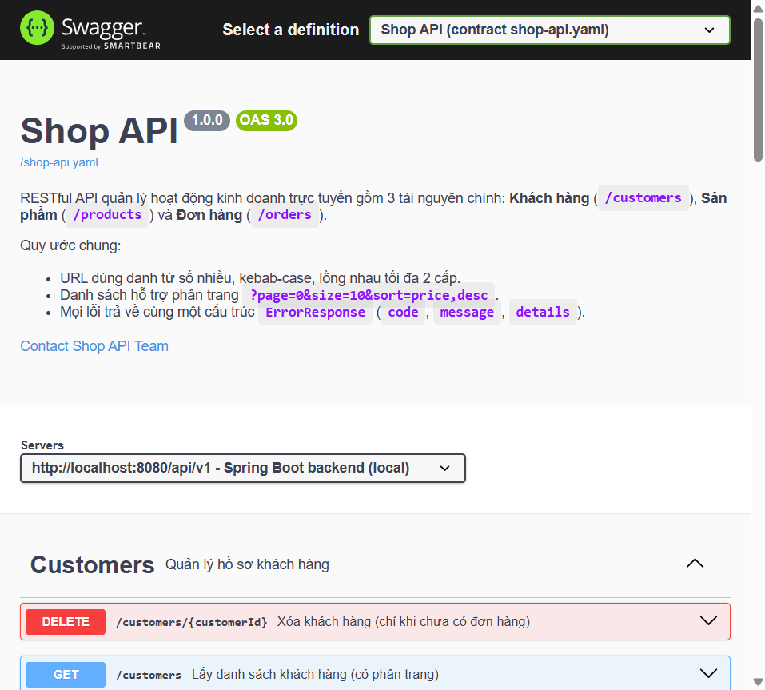

# Shop API – RESTful API theo quy trình API-First (Spring Boot 3)

Hệ thống quản lý **Khách hàng** (`/customers`), **Sản phẩm** (`/products`), **Đơn hàng** (`/orders`).

| Công nghệ | Phiên bản |
|---|---|
| Java | 21 (biên dịch `release 21`) |
| Spring Boot | 3.5.6 (Spring Data JPA, Validation, Web) |
| OpenAPI | 3.0.3 – `src/main/resources/shop-api.yaml` |
| Codegen | `openapi-generator-maven-plugin` 7.14.0 |
| Swagger UI | springdoc-openapi 2.8.9 |
| CSDL | MySQL / MariaDB (XAMPP, cổng 3307) |
| Mock Server | Prism 5 (`@stoplight/prism-cli`) |

## Cấu trúc thư mục

```
src/main/resources/shop-api.yaml   <- API Contract (viết TRƯỚC khi code)
pom.xml                            <- cấu hình openapi-generator-maven-plugin
target/generated-sources/openapi   <- Interfaces (CustomersApi, ProductsApi, OrdersApi) + DTOs sinh tự động
src/main/java/com/example/shop
  ├── controller   CustomersController implements CustomersApi, ...
  ├── service      @Transactional(readOnly = true) ở mức class, @Transactional cho hàm ghi
  ├── repository   Spring Data JPA (@EntityGraph chống N+1)
  ├── entity       Customer, Product, Order, OrderItem, OrderStatus
  ├── mapper       Entity <-> DTO
  ├── exception    ErrorResponse thống nhất (code, message, details)
  └── config       CORS, phục vụ /shop-api.yaml, dữ liệu mẫu
ui-prototype/                      <- Giao diện UI prototype (HTML/JS), chuyển được giữa Mock và Backend thật
docs/tai-lieu-phan-tich-BA.md      <- Tài liệu phân tích BA
docs/dac-ta-chuc-nang.md           <- Đặc tả mô tả chức năng
docs/screenshots/                  <- Ảnh minh chứng
```

## Bước 2.1 – Thiết kế API Contract

File `src/main/resources/shop-api.yaml`:

- `info`, `servers` (`http://localhost:8080/api/v1` và Prism `http://localhost:4010`), `tags`, `paths`, `components`.
- Ràng buộc validation: `required` → `@NotNull`, `format: email` → `@Email`, `minLength/maxLength` → `@Size`, `minimum` → `@Min` / `@DecimalMin`, `pattern` → `@Pattern`.
- Dữ liệu mẫu (`example`) cho mọi schema để Mock Server trả về.

Kiểm tra contract hợp lệ:

```bash
npm install
npm run lint:api
```

### Danh sách endpoint

| Method | URL | Mô tả | Status thành công |
|---|---|---|---|
| GET | `/customers?page=0&size=10&sort=fullName,asc&keyword=` | Danh sách khách hàng | 200 |
| POST | `/customers` | Tạo khách hàng | 201 + `Location` |
| GET | `/customers/{customerId}` | Chi tiết | 200 |
| PUT | `/customers/{customerId}` | Cập nhật toàn bộ | 200 |
| PATCH | `/customers/{customerId}` | Cập nhật một phần | 200 |
| DELETE | `/customers/{customerId}` | Xóa (chỉ khi chưa có đơn) | 204 |
| GET | `/customers/{customerId}/orders` | Lịch sử đơn hàng (lồng 2 cấp) | 200 |
| GET | `/products?page=0&size=10&sort=price,desc&keyword=&category=` | Danh sách sản phẩm | 200 |
| POST | `/products` | Tạo sản phẩm | 201 + `Location` |
| GET / PUT / PATCH / DELETE | `/products/{productId}` | Xem / sửa / xóa | 200 / 200 / 200 / 204 |
| GET | `/orders?page=0&size=10&sort=createdAt,desc&status=PENDING` | Danh sách đơn hàng | 200 |
| POST | `/orders` | Đặt hàng: tính tổng tiền, trừ tồn kho | 201 + `Location` |
| GET | `/orders/{orderId}` | Chi tiết đơn hàng | 200 |
| PATCH | `/orders/{orderId}` | Cập nhật trạng thái | 200 |
| DELETE | `/orders/{orderId}` | Xóa (PENDING/CANCELLED) | 204 |

Mã lỗi: `400` (validation, sort sai, JSON lỗi), `404` (không tìm thấy), `422` (vi phạm nghiệp vụ: trùng email,
hết hàng, chuyển trạng thái sai, xóa tài nguyên đang được dùng). Cấu trúc lỗi thống nhất:

```json
{
  "status": 422,
  "code": "INSUFFICIENT_STOCK",
  "message": "Không đủ hàng tồn kho để đặt hàng",
  "details": [{ "field": "items.quantity", "message": "Sản phẩm 'iPhone 16' (id = 1) chỉ còn 2, yêu cầu 5" }],
  "path": "/api/v1/orders",
  "timestamp": "2026-10-14T10:00:00Z"
}
```

Luồng trạng thái đơn hàng: `PENDING → CONFIRMED → SHIPPING → DELIVERED`; được `CANCELLED` khi đang
`PENDING`/`CONFIRMED` (hoàn lại tồn kho).

## Bước 2.2 – Chạy Mock API & kết nối UI/UX (Fail-Fast)

Chưa cần backend, chỉ cần Node.js:

```bash
npm install
npm run mock      # Prism Mock Server: http://127.0.0.1:4010 (dữ liệu từ các example trong YAML)
npm run ui        # Trang view (Node):  http://localhost:5500
```

Mở `http://localhost:5500`. Đây là phần view chạy bằng Node, mỗi tài nguyên một trang:

| Trang | Đường dẫn |
|---|---|
| Trang chủ | http://localhost:5500/ |
| Khách hàng | http://localhost:5500/customers |
| Sản phẩm | http://localhost:5500/products |
| Đơn hàng | http://localhost:5500/orders |

Ô **API** chuyển giữa backend thật (`http://localhost:8088/api/v1`) và Mock Server. Trang view chỉ hiển thị bảng và form; địa chỉ `http://localhost:8088/api/v1/...` vẫn trả JSON cho Postman và Swagger.
Prism cũng kiểm tra request theo contract (ví dụ thiếu `email` khi POST `/customers` sẽ bị từ chối),
giúp phát hiện sớm thiếu trường / sai cấu trúc trước khi viết backend.

Cách khác: import `shop-api.yaml` vào [Swagger Editor](https://editor.swagger.io) hoặc Postman → *Mock Servers*.



## Bước 2.3 – Sinh mã tự động & Backend

1. Khởi động MySQL (XAMPP Control Panel → MySQL → Start). Mặc định ứng dụng kết nối
   `jdbc:mysql://localhost:3307/shop_api`, user `root`, mật khẩu `123456` (DB tự tạo nếu chưa có).
   Đổi bằng biến môi trường `DB_URL`, `DB_USERNAME`, `DB_PASSWORD` nếu máy khác cấu hình.
2. Sinh code và chạy:

```bash
./mvnw generate-sources       # sinh Interfaces + DTOs vào target/generated-sources/openapi
./mvnw spring-boot:run        # hoặc: mvn spring-boot:run
```

Lần chạy đầu (hoặc khi database còn ít dữ liệu) tự thêm dữ liệu mẫu: 12 khách hàng, 15 sản phẩm và nhiều đơn ở các trạng thái khác nhau.

- Swagger UI: <http://localhost:8080/swagger-ui.html> (có 2 definition: contract `shop-api.yaml` và bản runtime của springdoc)
- Base URL API: <http://localhost:8080/api/v1>



Trong UI prototype, chọn **Nguồn dữ liệu = Backend thật** để chạy cùng giao diện với API thật.

### Tối ưu JPA

- Service đặt `@Transactional(readOnly = true)` ở mức class: Hibernate chuyển sang `FlushMode.MANUAL`,
  không lưu snapshot và bỏ qua Dirty Checking cho entity đọc ra → tiết kiệm CPU/RAM.
  Các hàm ghi (`create`, `replace`, `update`, `delete`) ghi đè bằng `@Transactional`.
- `spring.jpa.open-in-view=false`, mapping sang DTO ngay trong transaction.
- `@EntityGraph(attributePaths = "customer")` cho danh sách đơn hàng + `hibernate.default_batch_fetch_size=50`
  để tránh N+1 khi tải `items`.
- `@Version` trên `Product` (optimistic locking) để tránh bán vượt tồn kho khi đặt hàng đồng thời (trả 409).

## Kiểm thử tự động

```bash
./mvnw test
```

`ShopApiIntegrationTest` (H2 in-memory, không cần MySQL) kiểm tra: 201 + `Location`, 200, 204, 400, 404, 422,
phân trang/sắp xếp, tính tổng tiền, trừ và hoàn tồn kho, luồng trạng thái đơn hàng.
