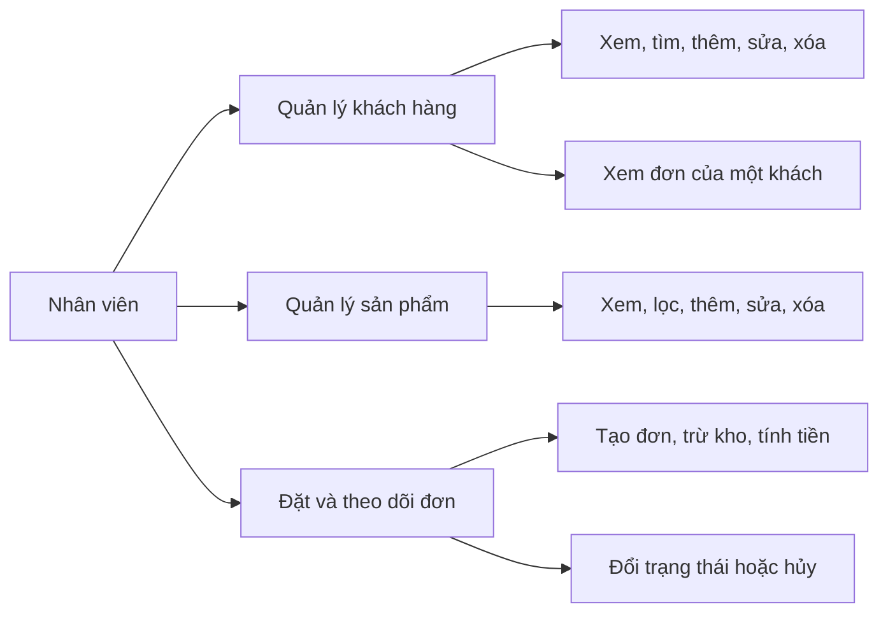
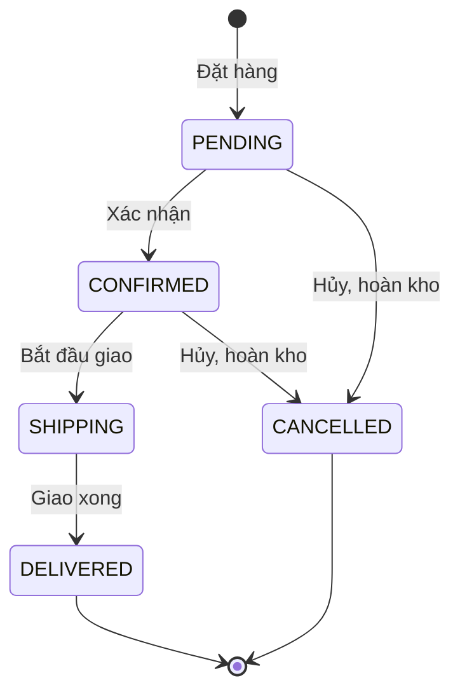

# Tài liệu phân tích nghiệp vụ (BA)

**Dự án:** Shop API – quản lý bán hàng trực tuyến  
**Quy trình:** API-First, OpenAPI 3.0, Spring Boot 3  
**Phiên bản tài liệu:** 1.0  
**Ngày:** 15/10/2026

## 1. Bối cảnh và mục tiêu

Cửa hàng cần một hệ thống để nhân viên theo dõi khách hàng, hàng hóa và đơn đặt hàng. Thay vì làm giao diện trước rồi mới nghĩ API, nhóm thống nhất **hợp đồng API trước** (`shop-api.yaml`) để frontend và backend làm song song.

Mục tiêu của đợt này:

- Chuẩn hóa cách đặt tên tài nguyên, động từ HTTP, mã trạng thái và JSON lỗi.
- Cho phép thử giao diện trên Mock Server trước khi backend xong.
- Lưu dữ liệu thật trên MySQL và giữ đúng quy tắc kho, giá, trạng thái đơn.

Người dùng của hệ thống trong phạm vi bài tập là **nhân viên bán hàng / quản trị cửa hàng**. Chưa có đăng nhập, phân quyền hay thanh toán trực tuyến.

## 2. Phạm vi

| Trong phạm vi | Ngoài phạm vi |
|---|---|
| Hồ sơ khách hàng | Đăng nhập, phân quyền |
| Danh mục sản phẩm và tồn kho | Thanh toán, hoàn tiền |
| Tạo đơn, tính tiền, đổi trạng thái, hoàn kho khi hủy | Khuyến mãi, voucher, thuế |
| Tìm kiếm, lọc, phân trang, sắp xếp | Gửi email, in hóa đơn |
| API JSON và trang xem trên trình duyệt | Ứng dụng mobile riêng |

## 3. Bên liên quan

| Vai trò | Việc cần làm |
|---|---|
| Nhân viên bán hàng | Tạo khách, thêm sản phẩm, đặt đơn, theo dõi giao hàng |
| Đội frontend / UI | Bám contract, ghép giao diện với Mock rồi với API thật |
| Đội backend | Sinh interface từ OpenAPI, viết nghiệp vụ, lưu MySQL |
| Người chấm bài | Đọc contract, chạy Mock, chạy `mvn spring-boot:run`, xem Swagger UI |

## 4. Khái niệm nghiệp vụ

- **Khách hàng:** người mua. Email là duy nhất, không phân biệt hoa thường.
- **Sản phẩm:** mặt hàng đang bán. Giá và tồn kho không âm. Sản phẩm đã nằm trong đơn thì không xóa được.
- **Đơn hàng:** một lần mua của một khách, gồm ít nhất một dòng hàng. Tổng tiền do hệ thống tính, không nhận từ người dùng.
- **Dòng hàng:** lưu tên và đơn giá **tại thời điểm đặt**. Đổi giá sản phẩm sau này không làm đổi đơn cũ.
- **Tồn kho:** giảm khi đặt đơn thành công. Chỉ hoàn lại khi đơn đang chờ hoặc đã xác nhận bị hủy, hoặc khi xóa đơn đang chờ.

## 5. Ca sử dụng

### UC-01. Quản lý khách hàng

Nhân viên xem danh sách, tìm theo tên hoặc email, mở hồ sơ, thêm mới, sửa toàn bộ hoặc một phần, xóa. Xóa bị từ chối nếu khách đã có đơn.

### UC-02. Quản lý sản phẩm

Nhân viên xem danh sách, tìm theo tên, lọc theo danh mục, sắp xếp theo giá, thêm, sửa, xóa. Xóa bị từ chối nếu sản phẩm đã có trong đơn.

### UC-03. Đặt hàng

Nhân viên chọn khách và ít nhất một sản phẩm kèm số lượng. Hệ thống kiểm tra khách và sản phẩm có tồn tại, gộp số lượng nếu cùng một sản phẩm xuất hiện hai lần, từ chối nếu kho không đủ, rồi trừ kho và tính tổng tiền. Địa chỉ giao để trống thì lấy địa chỉ của khách.

### UC-04. Theo dõi đơn

Nhân viên xem danh sách, lọc theo trạng thái, mở chi tiết và đẩy đơn theo luồng bên dưới. Hủy đơn đang chờ hoặc đã xác nhận thì hàng được trả về kho. Đơn đã giao hoặc đang giao không hủy và không xóa.

## 6. Quy trình trạng thái đơn

| Trạng thái | Ý nghĩa | Việc được làm tiếp |
|---|---|---|
| PENDING | Mới đặt, đã trừ kho | Xác nhận, hủy, xóa |
| CONFIRMED | Đã nhận đơn | Giao hàng, hủy |
| SHIPPING | Đang giao | Đánh dấu đã giao |
| DELIVERED | Đã giao | Không đổi, không xóa |
| CANCELLED | Đã hủy, đã hoàn kho | Chỉ được xóa |

## 7. Quy tắc nghiệp vụ

| Mã | Quy tắc | Khi vi phạm |
|---|---|---|
| BR-01 | Email khách không trùng | 422 `EMAIL_ALREADY_EXISTS` |
| BR-02 | Không xóa khách đã có đơn | 422 `CUSTOMER_HAS_ORDERS` |
| BR-03 | Không xóa sản phẩm đã nằm trong đơn | 422 `PRODUCT_IN_USE` |
| BR-04 | Số lượng đặt không vượt tồn kho | 422 `INSUFFICIENT_STOCK` |
| BR-05 | Chỉ đi theo luồng trạng thái ở mục 6 | 422 `INVALID_STATUS_TRANSITION` |
| BR-06 | Chỉ xóa đơn PENDING hoặc CANCELLED | 422 `ORDER_NOT_DELETABLE` |
| BR-07 | Tổng tiền = tổng (đơn giá lúc đặt × số lượng) | Hệ thống tự tính |
| BR-08 | Dữ liệu sai định dạng (email, độ dài, số âm, sort lạ) | 400 `VALIDATION_FAILED` hoặc `INVALID_SORT_FIELD` |
| BR-09 | Không tìm thấy khách, sản phẩm hoặc đơn | 404 `RESOURCE_NOT_FOUND` |

## 8. Yêu cầu phi chức năng trong phạm vi bài

- URL dùng danh từ số nhiều, kebab-case, lồng nhau tối đa hai cấp (`/customers/{id}/orders`).
- Danh sách phân trang `page`, `size` (1–100), `sort` dạng `trường,asc|desc`.
- Mọi lỗi cùng một dạng JSON: `status`, `code`, `message`, `details`, `path`, `timestamp`.
- Tạo mới trả 201 và header `Location`. Xóa thành công trả 204, không có body.
- Thao tác đọc gắn `@Transactional(readOnly = true)` để Hibernate bỏ qua dirty checking.

## 9. Giả định

- Một cửa hàng, một kho, giá bằng VND, không làm tròn thuế.
- Nhân viên dùng trình duyệt hoặc Swagger UI / Postman. Không có ứng dụng khách hàng tự đặt.
- MySQL chạy local (XAMPP, cổng 3307). Database `shop_api` được tạo nếu chưa có.
